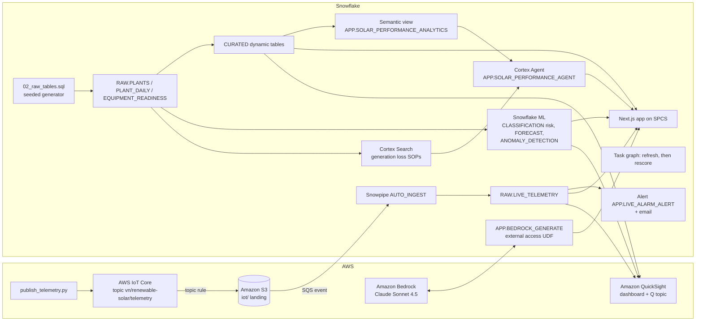

# Vietnam Solar Plant Performance Monitor

Solar plant performance monitoring for a **fictional solar operator's fleet of 30 plants across 6 Vietnam cities** (Phan Rang-Thap Cham, Phan Thiet, Tay Ninh, Cam Ranh, Buon Ma Thuot, Quy Nhon) using Snowflake, optionally with AWS: from ground-mount fixed-tilt and single-axis tracker plants through floating solar to rooftop C&I and solar-plus-storage sites, with in-range inverter-reading KPIs, a live inverter temperature alarm, a 7-day generation loss event-risk score, an alarm email and an AI action memo.

## Architecture

A solar performance pipeline built on **Snowflake** (Dynamic Tables, Snowflake ML, Cortex Search, Cortex Agent, Cortex AI_COMPLETE, SPCS) and, in the full build, **AWS** (IoT Core, S3, Bedrock Claude, QuickSight + Amazon Q). Inverter gateways (peak heatsink temperature, inverter load) land in `RAW.LIVE_TELEMETRY`. Dynamic tables curate 90 days of plant-day history: inverter readings, in-range readings (performance ratio inside the expected band for the plant type), string checks, string faults, generation loss events and plant availability. Snowflake ML scores 7-day generation loss event risk per plant, forecasts fleet-wide inverter-reading volume and flags peak inverter temperature anomalies. A Cortex Agent answers questions with SOP citations, and an LLM drafts the performance action memo.

Interactive diagrams (hover for object names): [Snowflake only](docs/architecture-snowflake.html) | [AWS + Snowflake](docs/architecture-aws.html). The app shows both on its Architecture & Data tab, the current build first. Regenerate them with `python3 docs/build_architecture.py`.



The Snowflake-only build drops the AWS subgraph: `APP.SIMULATE_TELEMETRY` writes to `RAW.LIVE_TELEMETRY`, and the app calls Cortex `AI_COMPLETE` instead of the Bedrock UDF.

## Snowflake Capabilities

| Capability | Implementation |
|-----------|---------------|
| Dynamic Tables | `CURATED.KPI_SUMMARY`, `PERFORMANCE_SUMMARY`, `LOSS_EVENT_CAUSES`, `TREND_ANALYSIS` from the RAW tables |
| Snowflake ML | CLASSIFICATION 7-day generation loss event risk (`ML.LOSS_EVENT_RISK_SCORES`), 14-day inverter-reading volume FORECAST, peak inverter temperature ANOMALY_DETECTION |
| Cortex Search | 20 synthetic generation loss response SOPs (one per plant type and cause) in `SEARCH.PLANT_SOP_SEARCH` |
| Semantic View | `APP.SOLAR_PERFORMANCE_ANALYTICS` over plants, loss causes, daily inverter readings and risk |
| Cortex Agent | `APP.SOLAR_PERFORMANCE_AGENT`: Cortex Analyst over the semantic view plus Cortex Search for SOP citations |
| Cortex AI | `AI_COMPLETE('claude-sonnet-4-5')` for grounded answers, and for the action memo in the Snowflake-only build |
| Alerts + Tasks | `APP.LIVE_ALARM_ALERT` logs ALARM readings and sends email; task graph `TASK_REFRESH_CURATED`, then `TASK_RESCORE_RISK` |
| Snowpark Container Services | Next.js app `APP.VN_RENEWABLE_SOLAR_APP` with 6 tabs: Executive Cockpit, Predictive, Plant Health, Live IoT, Ask AI, Architecture & Data |
| Snowpipe | `RAW.LIVE_TELEMETRY_PIPE` AUTO_INGEST from S3 (AWS build only) |

## AWS Services

Used only in the AWS + Snowflake build.

| Service | Role in Demo |
|---------|-------------|
| AWS IoT Core | Receives simulated inverter telemetry (peak heatsink temperature, inverter load). A topic rule writes each message to S3 |
| Amazon S3 | Landing bucket. An event notification goes to the Snowpipe SQS queue |
| Amazon Bedrock | Claude Sonnet 4.5 writes the action memo, called from Snowflake through an external-access UDF |
| Amazon QuickSight | DIRECT_QUERY executive dashboard over Snowflake (daily in-range inverter readings, generation loss events by plant, event risk) |
| Amazon Q | Natural-language questions over the QuickSight topic `vn-renewable-solar-topic` |
| AWS IAM | Least-privilege roles for S3, IoT and Bedrock |

## Personas

These personas are fictional.

| Persona | Role | Key Questions |
|---------|------|---------------|
| **Tran Quoc Bao** | Fleet Performance Director | "Which city has the lowest in-range rate?" "Which loss causes push the most inverter readings out of range?" |
| **Pham Thi Lan** | O&M Reliability Lead | "Which plants are high loss-event risk this week, and which SOP applies?" |

## Data

All data is synthetic and seeded, so every rebuild reproduces it. The solar operator, its plants and its fleet are fictional; the six cities are real Vietnam cities used as regions. No real company, plant, developer or grid operator is represented, and no generation, availability or grid-code performance is claimed for any real site.

| Table | Rows | Description |
|-------|------|-------------|
| RAW.PLANTS | 30 | Solar plants across 6 cities and 5 plant types (Ground-Mount Fixed Tilt, Single-Axis Tracker, Floating Solar, Rooftop C&I, Solar-plus-Storage) |
| RAW.PLANT_DAILY | 2,700 | Daily plant observations over 90 days: inverter readings, in-range readings, performance ratio, string checks, string faults, generation loss events, root cause, module-cleaning PM, peak inverter temperature and inverter load |
| RAW.EQUIPMENT_READINESS | 30 | Spare string inverters, tracker drive motors, pontoon float kits, inverter cooling fans or battery modules required and on hand per plant |
| SEARCH.PLANT_SOP_DOCS | 20 | Synthetic generation loss response SOPs indexed for Cortex Search |
| RAW.LIVE_TELEMETRY | Grows during the demo | Live readings from IoT Core (AWS build) or `APP.SIMULATE_TELEMETRY` (Snowflake-only build) |
| ML.LOSS_EVENT_RISK_SCORES | 30 | 7-day generation loss event probability and risk band per plant |

Inverter traceability: each plant-day carries in-range readings and the performance ratio of the inverters it monitored, and every SOP asks technicians to log the affected inverter and string IDs and confirm SCADA values with a handheld check.

## Build Instructions

### Prerequisites
- Snowflake account with ACCOUNTADMIN access, and Cortex AI enabled (AI_COMPLETE, Search, Agent).
- An X-Small warehouse with auto-suspend at or below 120 s, and an existing SPCS compute pool.
- Python 3.11+, `snowflake-connector-python`, Node.js 22+, Docker and the `snow` CLI.
- App image: run `snow spcs image-registry login`, then build and push `vn-renewable-solar-app:v1` to the database's `APP.IMAGES` repository (see the header of `snowflake/07_deploy_app.sql`).
- AWS build only: `boto3`, AWS credentials for the target account (us-west-2) with Bedrock access, and QuickSight Enterprise.

### SPCS App
```
<DATABASE>.APP.VN_RENEWABLE_SOLAR_APP
```

### Tests
```bash
python -m pytest aws snowflake quicksight
```

For a local run, put `SNOWFLAKE_ACCOUNT`, `SNOWFLAKE_USER`, `SNOWFLAKE_DATABASE`, `SNOWFLAKE_WAREHOUSE`, `SNOWFLAKE_AUTHENTICATOR=PROGRAMMATIC_ACCESS_TOKEN`, `SNOWFLAKE_TOKEN` and `DEMO_PLATFORM` in the environment, then run `npm --prefix app run build && npm --prefix app start`.

## Build Modes

Both modes share the same core. They differ in three places, and the app's `DEMO_PLATFORM` setting (in its SPCS spec) switches the memo provider and the Live IoT tab.

| Layer | Snowflake Only | Full AWS + Snowflake |
|---|---|---|
| Live telemetry | `CALL APP.SIMULATE_TELEMETRY(n)` inserts simulated readings into `RAW.LIVE_TELEMETRY`. This simulates a sensor feed; it is not Snowpipe Streaming | `aws/publish_telemetry.py` to AWS IoT Core, then S3, SQS and Snowpipe AUTO_INGEST |
| Action memo | Cortex `AI_COMPLETE('claude-sonnet-4-5')` | Amazon Bedrock Claude Sonnet 4.5 through `APP.BEDROCK_GENERATE` |
| BI and natural-language questions | The SPCS app is the dashboard; questions go to the Cortex Agent | Also a QuickSight dashboard and an Amazon Q topic |
| App setting | `DEMO_PLATFORM: snowflake` | `DEMO_PLATFORM: aws` |

### Snowflake Only

```bash
# 1. Core data and dynamic tables (guarded: new isolated database only)
python snowflake/run_core.py --database VIETNAM_RENEWABLE_SOLAR_SNOWFLAKE --warehouse <XS_WAREHOUSE> --connection <CONNECTION> --apply
# 2. Native telemetry, ML, search, semantic view, agent, alert and task graph
python snowflake/run_intelligence.py --database VIETNAM_RENEWABLE_SOLAR_SNOWFLAKE --platform snowflake --warehouse <XS_WAREHOUSE> --connection <CONNECTION> --alert-email you@example.com
# 3. App on SPCS with DEMO_PLATFORM=snowflake (push the image first)
python snowflake/run_intelligence.py --database VIETNAM_RENEWABLE_SOLAR_SNOWFLAKE --platform snowflake --warehouse <XS_WAREHOUSE> --connection <CONNECTION> --alert-email you@example.com --files 07_deploy_app.sql --compute-pool <COMPUTE_POOL>
```

During the demo:
- Run `CALL APP.SIMULATE_TELEMETRY(20)` to add live readings. For a continuous feed, run `ALTER TASK APP.TASK_SIMULATE_TELEMETRY RESUME`, and `SUSPEND` it afterwards.
- Run `EXECUTE ALERT APP.LIVE_ALARM_ALERT` to raise the alarm email.
- Run `EXECUTE TASK APP.TASK_REFRESH_CURATED` to refresh the curated tables and rescore risk.

Afterwards, drop the database or run `ALTER SERVICE APP.VN_RENEWABLE_SOLAR_APP SUSPEND`.

### Full AWS + Snowflake

```bash
# 1. Core data and dynamic tables (guarded: new isolated database only)
python snowflake/run_core.py --database VIETNAM_RENEWABLE_SOLAR_AWS --warehouse <XS_WAREHOUSE> --connection <CONNECTION> --apply
# 2. AWS ingestion and Bedrock (dry run first, then --apply)
python aws/setup_aws.py --database VIETNAM_RENEWABLE_SOLAR_AWS --account <AWS_ACCOUNT_ID> --connection <CONNECTION> --apply
# 3. ML, search, semantic view, agent, alert and task graph
python snowflake/run_intelligence.py --database VIETNAM_RENEWABLE_SOLAR_AWS --platform aws --warehouse <XS_WAREHOUSE> --connection <CONNECTION> --alert-email you@example.com
# 4. App on SPCS with DEMO_PLATFORM=aws (push the image first)
python snowflake/run_intelligence.py --database VIETNAM_RENEWABLE_SOLAR_AWS --platform aws --warehouse <XS_WAREHOUSE> --connection <CONNECTION> --alert-email you@example.com --files 07_deploy_app.sql --compute-pool <COMPUTE_POOL>
# 5. QuickSight dashboard and Q topic (needs an existing Snowflake data source)
python quicksight/build_dashboards.py --database VIETNAM_RENEWABLE_SOLAR_AWS --account <AWS_ACCOUNT_ID> --principal-arn <QUICKSIGHT_USER_ARN> --data-source-arn <DATA_SOURCE_ARN> --prefix vn-renewable-solar --apply --update --with-topic
```

QuickSight objects must be shared with the QuickSight user who signs in (`--principal-arn`); otherwise the console shows nothing.

During the demo:
- Run `python aws/publish_telemetry.py --count 20` to send live readings.
- Run `EXECUTE ALERT APP.LIVE_ALARM_ALERT` to raise the alarm email.
- Run `EXECUTE TASK APP.TASK_REFRESH_CURATED` to refresh the curated tables and rescore risk.

Afterwards, `python aws/teardown_aws.py --database VIETNAM_RENEWABLE_SOLAR_AWS --account <AWS_ACCOUNT_ID> --connection <CONNECTION> --apply` removes the AWS resources and the account-level Bedrock external-access and S3 storage integrations. It leaves the email integration `VN_RENEWABLE_SOLAR_EMAIL_INT`, which the Snowflake-only build also uses.

## Business Impact

Context from public research and agency pages:
- **Policy drove Vietnam's solar and wind expansion**: "Generous feed-in tariffs are found to have been a key driver, with income tax and land lease payment exemptions also being important." -- [Do et al. (2021), *Vietnam's solar and wind power success: Policy implications for the other ASEAN countries*, Energy for Sustainable Development (ANU Open Research)](https://openresearch-repository.anu.edu.au/handle/1885/248804)
- **The grid is the constraint**: "The main barriers include a high level of policy uncertainty and an underprepared transmission grid." -- [same study](https://openresearch-repository.anu.edu.au/handle/1885/248804)
- **Inverters sit at the centre of a solar plant**: "An inverter is one of the most important pieces of equipment in a solar energy system." -- [U.S. Department of Energy, Solar Integration: Inverters and Grid Services Basics](https://www.energy.gov/eere/solar/solar-integration-inverters-and-grid-services-basics)

These are industry and research statements, not outcomes of this demo or of any Vietnam plant.

## Key Demo Numbers

These figures are synthetic and come from the seeded demo data. Forecast and anomaly figures can shift slightly with the build day.

- **30 solar plants**, 2,700 plant-days over 90 days, across 6 cities and 5 plant types; **1,122,131 inverter readings**
- **In-range inverter readings 90.0%**; per-plant in-range rate ranges from 85.6% to 92.6%, and Tay Ninh is the lowest city at 87.9%
- **427 generation loss events** across 14 root causes; tracker motor faults push the most inverter readings out of range
- **Event-risk model** out-of-time holdout: precision 0.66, recall 0.69 at a 0.5 threshold, against a 0.54 base rate (a modest lift; present it as triage). 18 plants are high risk; the top plant is SP-0001, at 99.8%
- **14-day inverter-reading volume forecast** with prediction intervals; **27 of 480** plant-days flagged as peak inverter temperature anomalies
- **Plant availability 98.1%**, spare-parts readiness 82.2%, 18.74 string faults per 1,000 string checks
- **20 SOPs** indexed for Cortex Search and cited by ID in agent answers

## License

Apache 2.0 — See [LICENSE](LICENSE) for details.

This is a personal demo project and is not an official Snowflake offering. It comes with no support or warranty. Industry statements cited are from publicly available third-party research and agency pages; they describe the industry and are not guarantees of results.
